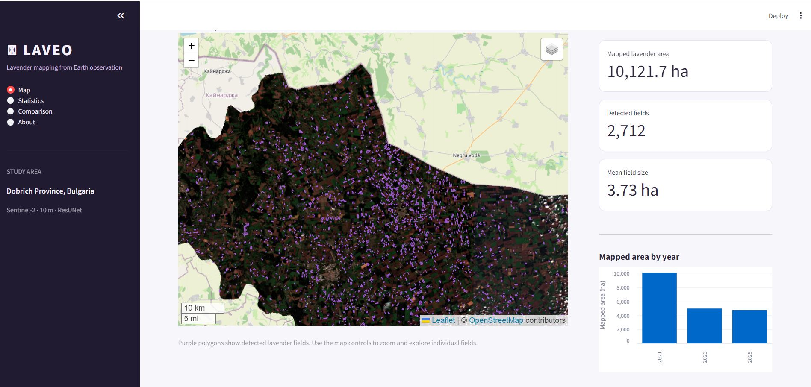

# LAVEO: Lavender Area Vectorisation with Earth Observation

LAVEO is a geospatial AI project for mapping lavender fields from Sentinel-2 satellite imagery using deep learning and geospatial post-processing.

The project uses a ResUNet semantic segmentation model to identify lavender fields, followed by raster-to-vector conversion and geometry processing to produce georeferenced field boundaries.



## 1. Workflow

The processing workflow consists of six main stages:

1. **Satellite imagery acquisition** – Downloads Sentinel-2 imagery for the training and prediction areas.
2. **Data preparation** – Prepares imagery, labels and spatial patches for model development and inference.
3. **Input preparation** – Organises image tiles and input data for the machine learning workflow.
4. **Deep learning segmentation** – Trains and evaluates a ResUNet model using labelled lavender field data.
5. **Full-tile inference** – Applies the trained model to satellite imagery to generate lavender probability or binary prediction rasters.
6. **Geospatial post-processing** – Converts raster predictions into polygons, removes small polygons and simplifies boundaries while preserving topology.

The workflow is orchestrated using Dagster.

## 2. Study Area and Data

**Study area:** Dobrich Province, Bulgaria.

### Input datasets

The repository includes:

- Training lavender field boundaries (2021, 2023 and 2025).
- Test lavender field boundaries (2021, 2023 and 2025).
- Training Area of Interest (AOI).
- Test Area of Interest (AOI).

These datasets are stored in:

```text
data/
├── labels/
│   ├── Train_Bg_Lavender fields-07-2021.geojson
│   ├── Train_Bg_Lavender fields-07-2023.geojson
│   ├── Train_Bg_Lavender fields-07-2025.geojson
│   ├── Test_Bg_Lavender fields-07-2021.geojson
│   ├── Test_Bg_Lavender fields-07-2023.geojson
│   └── Test_Bg_Lavender fields-07-2025.geojson
└── training&val_aoi/
    ├── Bulgaria_Dobrich_training_AOI.geojson
    └── Bulgaria_Dobrich_test_AOI.geojson
```

Satellite imagery and intermediate processing products are generated during pipeline execution and are not included in the repository.

## 3. Technology

- Python 3.11
- PyTorch
- NumPy and Pandas
- Rasterio and Rasterio-based geospatial processing
- GeoPandas
- Shapely
- Xarray and Rioxarray
- Dagster
- Streamlit
- Folium
- Sentinel-2 satellite imagery

## 4. Installation

### Requirements

- Windows, Linux or macOS.
- Miniconda or Anaconda.
- Git.
- Internet connection for satellite imagery acquisition and dependency installation.

### Clone the repository

```bash
git clone YOUR_GITHUB_REPOSITORY_URL
cd LAVIS
```

Replace `YOUR_GITHUB_REPOSITORY_URL` with the actual repository URL.

### Create the Conda environment

```bash
conda env create -f environment.yml
```

Activate the environment:

```bash
conda activate lavis
```

Verify the main dependencies:

```bash
python --version
dagster --version
streamlit --version
python -c "import torch, rasterio, geopandas; print('Dependencies OK')"
```

## 5. Running the project

There are three ways to interact with the project.

### Option A: Run the processing scripts individually

Individual Python scripts can be executed directly from the project root.

This approach is useful for:
- Development and debugging.
- Testing individual processing stages.
- Inspecting intermediate outputs.
- Re-running selected processing steps.

Use the relevant Python scripts in `src/lavender/` and their corresponding configurations.

The required input data and output directories must be available before running each script.

### Option B: Run the complete workflow using Dagster (recommended)

Dagster manages the processing workflow through assets and their dependencies.

From the project root, start the Dagster development server:

```bash
dagster dev -m orchestration.definitions
```

Open the Dagster interface at:

```text
http://localhost:3000
```

The project defines assets for:

1. Downloading training and prediction tiles.
2. Preparing training and prediction tiles.
3. Preparing model input tiles.
4. Training and evaluating the model.
5. Generating full-tile predictions.
6. Post-processing the predictions.

In the Dagster interface, inspect the asset graph and materialise the required assets.

**Note:** Running Dagster definitions validation only checks that the workflow definitions can be loaded. It does not execute the complete processing pipeline.

### Option C: Run the Streamlit visualisation

The project includes a Streamlit application for visualising geospatial predictions.

From the project root:

```bash
streamlit run frontend/app.py
```

The application opens in a browser, normally at:

```text
http://localhost:8501
```

The visualisation requires the relevant prediction and geospatial output files to have been generated.

## 6. Project structure

```text
LAVIS/
├── data/
│   ├── labels/
│   └── training&val_aoi/
│
├── docs/
│   └── images/
│
├── frontend/
│   └── app.py
│
├── ml/
│   └── models/
│
├── orchestration/
│   ├── __init__.py
│   └── definitions.py
│
├── src/
│   └── lavender/
│       ├── ingestion/
│       ├── ml/
│       │   ├── dataset/
│       │   ├── eval/
│       │   ├── inference/
│       │   ├── models/
│       │   └── training/
│       ├── postprocessing/
│       └── utils/
│
├── environment.yml
├── .gitignore
├── LICENSE
└── README.md
```

## 7. Outputs

The project produces:

- Georeferenced raster predictions.
- Vector polygon datasets representing detected lavender fields.
- Model evaluation metrics.
- Intermediate image patches and processing products.

The vector outputs represent predicted lavender field boundaries in Dobrich Province, Bulgaria.

Generated data, model checkpoints and intermediate files are excluded from GitHub to keep the repository manageable.

## 8. Limitations

1. Current predictions use single-date satellite imagery. More effective cloud masking or mosaicking of cloud-free imagery could improve prediction quality.
2. Prediction quality depends on satellite image conditions, spatial resolution and the quality of training labels.
3. Cross-region transferability and the quality of mapped field boundaries require further evaluation.

## 9. Project status

**Research and development.**

The workflow is being developed and evaluated for lavender field detection, geospatial boundary extraction and cross-region transferability.

## 10. License

See the [LICENSE](LICENSE) file for licensing information.